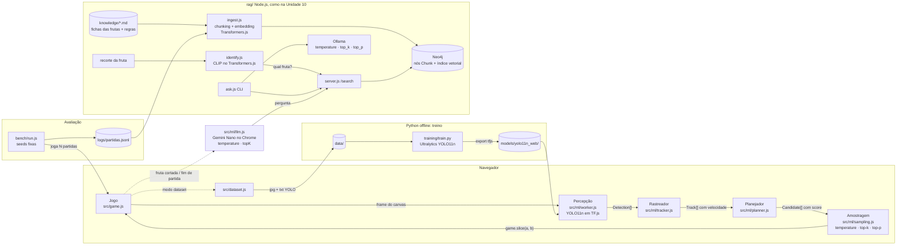
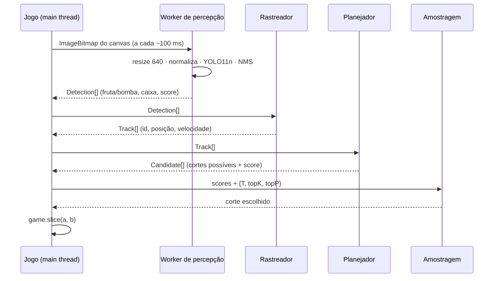
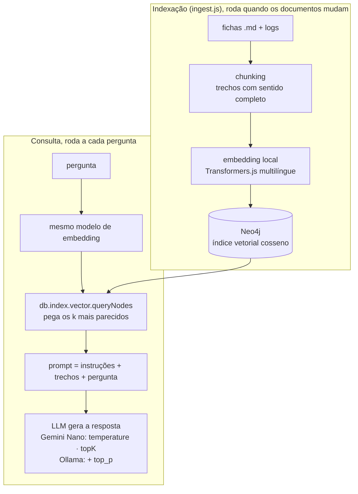
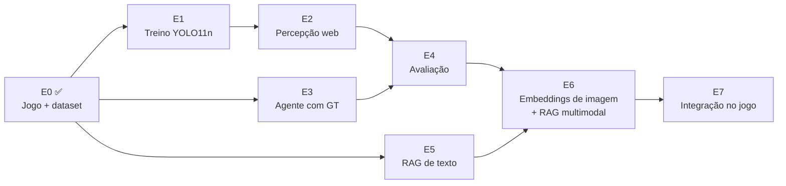

# Arquitetura: Cortaí

Objetivo: uma IA que **vê** o jogo (visão computacional), **decide** onde cortar (agente com amostragem
temperature/top-k/top-p) e **explica** o que acontece (RAG com embeddings). Cada parte é um módulo com
dono, entrada e saída definidas, para os agentes trabalharem em paralelo sem conflito.

---

## 1. Visão geral



### Um frame do jogo, passo a passo



### RAG: indexar uma vez, consultar muitas



---

## 2. Pastas: para que serve cada uma

```
cortai/
├── index.html            página do jogo
├── src/                  JOGO (pronto, Etapa 0)
│   ├── game.js           física, corte, pontos, vidas, rótulos YOLO
│   ├── main.js           mouse → game.slice, loop de frames
│   ├── dataset.js        grava imagens + rótulos para o treino
│   └── ml/               IA no navegador
│       ├── worker.js     PERCEPÇÃO: frame → Detection[] (YOLO11n TF.js)
│       ├── tracker.js    associa detecções entre frames, estima velocidade
│       ├── planner.js    gera cortes candidatos e dá nota a cada um
│       ├── sampling.js   temperature / top-k / top-p sobre as notas
│       ├── agent.js      liga tudo: worker → tracker → planner → sampling → slice
│       └── llm.js        Gemini Nano no Chrome (Prompt API) + RAG via rag/server.js
├── assets/               arte SVG das frutas e da bomba
├── data/                 dataset gerado (NÃO versionar, é grande)
├── training/             Python: treino e export do YOLO
│   ├── requirements.txt
│   ├── train.py          treina YOLO11n e mostra métricas (mAP)
│   └── export.py         converte para TF.js → models/
├── models/yolo11n_web/   modelo pronto para o navegador
├── bench/                avaliação reproduzível
│   └── run.js            N partidas com seeds fixas → logs/ + relatório
├── logs/                 partidas.jsonl (uma linha por partida)
├── rag/                  Node.js: embeddings + RAG (mesma stack da Unidade 10)
│   ├── knowledge/        fichas das frutas (.md) e regras do jogo
│   ├── embed.js          carrega o modelo de embedding do Transformers.js (texto e CLIP)
│   ├── ingest.js         chunking + embedding → nós :Chunk no Neo4j + índice vetorial
│   ├── search.js         busca por similaridade (db.index.vector.queryNodes)
│   ├── server.js         HTTP local: POST /search para o jogo e a CLI
│   ├── ask.js            CLI: pergunta → resposta com fontes (Ollama, os 3 parâmetros)
│   ├── identify.js       CLIP: recorte de fruta → qual fruta é
│   └── experiments/      varreduras de temperature/top-k/top-p
├── docs/                 esta arquitetura + nota de estudo
├── .claude/agents/       definições dos subagentes
└── test.js               checagem da lógica do jogo
```

---

## 3. Contratos (o que passa entre os módulos)

Cada agente só pode mudar o formato de um contrato depois de combinar com o orquestrador.

```js
// worker.js → agent.js
Detection = { cls: 'fruta' | 'bomba', x, y, w, h, score }   // x,y = centro em px do canvas 960×540

// tracker.js → planner.js
Track = Detection & { id: number, vx: number, vy: number, age: number }  // px/s

// planner.js → sampling.js
Candidate = { a: {x, y}, b: {x, y}, hits: number[], bombs: number, score: number }

// sampling.js
sample(scores: number[], { temperature, topK, topP }, rand) → index
// temperature = 0 → escolhe o maior (greedy)

// bench/run.js → logs/partidas.jsonl (uma linha por partida)
{ seed, perception: 'gt' | 'yolo', params: { temperature, topK, topP },
  score, bombHit: boolean, misses, durationS }

// Neo4j: nó (:Chunk {id, source, text, embedding}) com índice vetorial cosseno
// rag/server.js
POST /search { query, k = 4 } → [{ text, source, score }]
```

**Modo `gt` (ground truth):** `game.labels()` já fornece detecções perfeitas. Os agentes do planejador
e da avaliação trabalham com ele **sem esperar** o modelo treinado. Trocar `gt` → `yolo` mede quanto se
perde por causa da visão.

---

## 4. Escolha do modelo de visão

**YOLO11n (Ultralytics)** no lugar do YOLOv5n:
- mais preciso e mais leve que o v5n no mesmo tamanho "nano";
- exporta direto para TF.js (`model.export(format="tfjs")`), mesmo caminho do Duck Hunt;
- treino em poucas linhas e roda em CPU (lento) ou GPU.

Diferença prática em relação à aula: o YOLOv5 do Duck Hunt já saía com NMS embutido (três saídas
prontas: `boxes`, `scores` e `classes`). A saída do YOLO11 é `[1, 4 + classes, 8400]` e **não traz NMS**. O worker aplica
`tf.image.nonMaxSuppressionAsync`. Versões mais novas da Ultralytics podem ser trocadas sem mudar o
contrato `Detection`.

Duas classes (`fruta`, `bomba`): é tudo que a decisão de corte precisa. **Qual** fruta é fica a cargo
dos embeddings de imagem (Etapa 6). É uma escolha didática: mostra a recuperação por similaridade
funcionando, e uma fruta nova entra só adicionando exemplos ao índice, sem retreinar.

---

## 5. Etapas de execução



E1, E3 e E5 podem rodar **em paralelo**.

| Etapa | Agente | Entrega | Pronto quando |
|---|---|---|---|
| **E0** ✅ | (feito) | jogo, arte, `dataset.js`, `test.js` | `npm test` ok |
| **E1** Treino | `treinador-visao` | `training/`, `models/yolo11n_web/`, relatório | mAP50 ≥ 0.90 nas duas classes no `val` |
| **E2** Percepção | `percepcao-web` | `src/ml/worker.js` | IoU médio com `game.labels()` ≥ 0.7 e < 100 ms por frame |
| **E3** Agente | `agente-jogador` | `tracker.js`, `planner.js`, `sampling.js`, `agent.js` | modo `gt`: média ≥ 40 pontos, bomba em < 10% das partidas |
| **E4** Avaliação | `avaliador` | `bench/run.js`, `logs/`, relatório | tabela gt × yolo e varredura de T/top-k/top-p |
| **E5** RAG | `engenheiro-rag` | `rag/` (knowledge, ingest, search, server, ask, experiments) + `src/ml/llm.js` | responde citando as fontes; experimento de sampling documentado |
| **E6** Multimodal | `engenheiro-rag` | `identify.js`, gráfico 2D dos embeddings | acerta ≥ 90% das frutas por vizinho mais próximo |
| **E7** Integração | orquestrador | painel no jogo: curiosidade da fruta e "por que perdi?" | funciona ponta a ponta |

O dataset (E1) precisa que **você** clique em "Gerar dataset" e escolha `data/`. A janela de pasta é
do sistema e o agente não consegue operá-la. Meta: 3 a 5 mil frames.

---

## 6. Agentes

| Agente | Responsável por | Pode escrever em | Lê |
|---|---|---|---|
| orquestrador (sessão principal) | plano, contratos, integração, revisão | `docs/`, `src/main.js`, integração | tudo |
| `treinador-visao` | dataset, treino e export do YOLO | `training/`, `models/` | `data/`, `src/game.js` |
| `percepcao-web` | worker TF.js, decodificação, NMS | `src/ml/worker.js` | `models/`, contratos |
| `agente-jogador` | rastreio, candidatos de corte, amostragem | `src/ml/tracker.js`, `planner.js`, `sampling.js`, `agent.js` | `src/game.js`, contratos |
| `avaliador` | benchmark, métricas, testes | `bench/`, `logs/`, `test.js` | tudo |
| `engenheiro-rag` | embeddings, Neo4j, recuperação, geração | `rag/`, `src/ml/llm.js` | `logs/`, `docs/NOTA-IA.md` |

### Pré-requisitos que só você pode instalar
- **Neo4j** (Desktop ou o mesmo jeito usado na Unidade 10), com usuário e senha em `rag/.env`.
- **Gemini Nano no Chrome**: ativar as flags da Prompt API como na Unidade 5. Se não estiver
  disponível, `llm.js` usa o Ollama pelo `server.js`.
- **Ollama** com um modelo pequeno (ex.: `ollama pull qwen2.5:3b`), para o experimento com top-p.
- **Python 3.11** só para o treino do YOLO (E1).

Regras comuns: nenhum agente edita pasta de outro; mudança de contrato passa pelo orquestrador; cada
um termina com um relatório curto (o que fez, como verificar, números obtidos).
